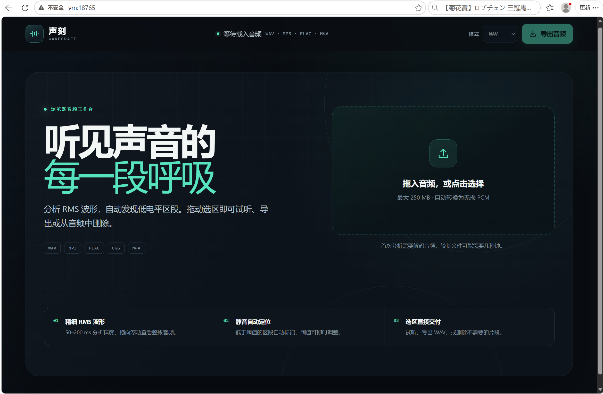
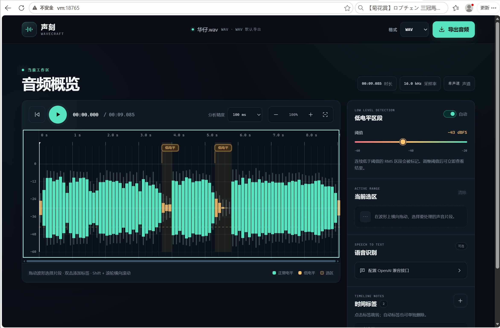

# 声刻 WaveCraft

基于 FastAPI + 原生 HTML/CSS/JavaScript 的浏览器音频编辑工具。上传音频后会由服务端
解码为 PCM、计算 RMS 波形，并在浏览器中提供可横向滚动的时间线，适合播客剪辑、录音
整理、静音段排查和语音转写等场景。

## 界面





[](LICENSE)
[](https://www.python.org/)
[](https://fastapi.tiangolo.com/)
[](static/app.js)
[](docker-compose.yml)

> WaveCraft 采用 **Apache License 2.0 + Commons Clause**：可以用于商业项目、修改和
> 再分发，但不能把本软件或其实质功能单独包装成收费产品或收费托管服务。完整条款见
> [LICENSE](LICENSE)，使用边界见[许可与商用说明](docs/许可与商用说明.md)。

## 功能

- RMS 波形分析：50 ms、100 ms、200 ms 三档分析精度。
- 长音频横向滚动：时间线画布仅绘制可见区域，避免超宽 Canvas。
- 低电平自动标记：阈值在 `-60 dBFS` 到 `-20 dBFS` 之间可调。
- 时间标签：可自动标记低电平区段，也可在当前播放头位置手动添加、删除标签。
- 片段选择：拖动波形选择一段音频，拖动选区边缘可微调。
- 精确选区试听：播放服务端按采样帧切出的独立片段，不依赖完整音频的 seek。
- 防止边界爆音：选区导出会在首尾自动应用 5 ms 淡入淡出。
- 选区播放、删除和 WAV/MP3/FLAC/M4A/OGG/OPUS/AIFF/AAC/WEBM/WMA 导出。
- 导出格式默认沿用上传格式（例如上传 MP3 默认导出 MP3）。
- 最近一次音频删除可撤销。
- OpenAI 兼容语音识别接口：支持整段一次识别，或按 15–60 秒自动切段识别，结果对齐显示在时间轴下方。
- API Key 只在浏览器内提交给本站后端并即时转发，不写入服务端磁盘或日志。

## 项目结构

```text
wave-craft/
├── app.py                  # FastAPI 后端、音频分析/编辑/导出与 ASR 转发
├── static/                 # 原生前端：页面、样式和交互逻辑
├── tests/                  # 接口与音频处理测试
├── Dockerfile              # 非 root 用户运行的应用镜像
├── docker-compose.yml      # 单命令启动与持久化数据卷
├── CONTRIBUTING.md         # 开发、测试和提交约定
├── SECURITY.md             # 漏洞报告与自托管安全须知
├── LICENSE                 # Apache-2.0 + Commons Clause
└── docs/                   # 许可与商用说明
```

## Docker 启动

需要 Docker 24+ 与 Docker Compose v2+。

```bash
docker compose up -d --build
```

浏览器打开 [http://localhost:8000](http://localhost:8000)。查看容器状态与日志：

```bash
docker compose ps
docker compose logs -f audio-editor
```

如果宿主机 `8000` 端口已被占用，可更换映射端口：

```bash
WAVECRAFT_PORT=8765 docker compose up -d --build
```

随后访问 `http://localhost:8765`。

停止服务：

```bash
docker compose down
```

音频项目保存在命名卷 `audio-editor-data` 中。执行 `docker compose down -v` 会同时删除已上传和编辑产生的服务端项目文件，该操作不可恢复。

## 本机直接运行

```bash
python3 -m venv .venv
source .venv/bin/activate
pip install -r requirements.txt
uvicorn app:app --reload --host 0.0.0.0 --port 8000
```

默认数据目录为 `./data`，可通过 `AUDIO_EDITOR_DATA` 修改：

```bash
AUDIO_EDITOR_DATA=/tmp/wavecraft-data uvicorn app:app --host 0.0.0.0 --port 8000
```

## ASR 配置

在右侧“语音识别”区域填写：

- Base URL：例如 `https://api.openai.com/v1`。
- API Key：留空可连接不需要鉴权的本地兼容服务。
- 模型：例如 `whisper-1`；具体可用名称以所连接服务为准。
- 语言：自动检测或按需指定。
- 处理方式：
  - 自动分段：按固定时长切成 WAV 片段，逐段调用转写接口。分段结果会分别对齐到对应时间段。
  - 整段识别：把当前完整音频作为一次请求发送。适合短音频或支持长音频的上游服务。

服务端会请求以下 OpenAI 风格的转写地址，并发送 multipart 字段 `file`、`model`、`response_format=json`，可选发送 `language` 与 `prompt`：

```text
POST {base_url}/audio/transcriptions
Authorization: Bearer {api_key}
```

如果 Base URL 没有 `/v1`，服务会自动追加 `/v1/audio/transcriptions`；如果填写的本身就是以 `/audio/transcriptions` 结尾的完整地址，则原样使用。

## 时区与限制

- 单文件上传默认上限 250 MB，可由 `AUDIO_EDITOR_MAX_UPLOAD_MB` 调整。
- FFmpeg 由 `imageio-ffmpeg` 随 Python 依赖安装，不依赖宿主机单独安装 FFmpeg。
- 自动分段识别最多生成 200 个片段；音频很长时请提高每段时长。
- 当前未实现多用户鉴权。若暴露到公网，请增加反向代理鉴权、HTTPS、访问频率限制和定期清理策略。

## API

- `POST /api/audio?resolution_ms=100`：上传音频并分析。
- `GET /api/audio/{id}/analysis?resolution_ms=100`：重新分析。
- `GET /api/audio/{id}/media`：播放当前音频。
- `GET /api/audio/{id}/selection-preview?start=0&end=10`：播放精确选区片段。
- `GET /api/audio/{id}/export?start=0&end=10&format=mp3`：导出选区或整段。
- `POST /api/audio/{id}/delete`：删除音频时间段。
- `POST /api/audio/{id}/undo`：撤销最近一次删除。
- `POST /api/audio/{id}/transcribe`：调用 OpenAI 兼容 ASR。

FastAPI 生成的接口文档位于 `http://localhost:8000/docs`。

## 测试

```bash
pytest -q
```

## 参与贡献

欢迎提交缺陷报告、功能建议和 Pull Request。开始开发前请阅读
[CONTRIBUTING.md](CONTRIBUTING.md)；安全问题请不要公开提交 Issue，按
[SECURITY.md](SECURITY.md) 中的私下渠道报告。

## 许可证与商用

本项目采用 **Apache License 2.0 + Commons Clause License Condition v1.0**，完整条款
见 [LICENSE](LICENSE)。

| 你可以 | 你不可以 |
| --- | --- |
| 商用：部署到自己的业务中、按需修改和二次开发 | 把本软件或其实质功能包装成收费产品向第三方销售 |
| 复制、免费再分发，并保留版权与许可声明 | 未经授权对外提供以本软件价值为主的收费托管服务 |
| 学习研究、内部教学和自托管使用 | 移除或篡改版权与许可声明 |

> Commons Clause 增加了“不得销售软件本身”的条件，因此本项目属于
> **source-available（源码可见）**，不是 OSI 认证的开源许可。中文说明见
> [docs/许可与商用说明.md](docs/许可与商用说明.md)。

商业授权、定制开发与技术支持（版权所有者可另行授权）：
`4198166@qq.com` · 微信 `4198166` · 电话 `+86 185 7281 7101`。

## 免责声明

- 音频文件由使用者自行提供并对其拥有合法处理权限；使用 ASR 时，音频会发送到你配置的
  第三方服务，请先确认数据合规与隐私要求。
- 项目按“原样”提供，不附带任何明示或默示担保。部署到公网前，请完成鉴权、HTTPS、
  访问限流、日志与备份等安全加固。
- 本项目不承诺音频处理结果或第三方识别结果的准确性，重要音频请保留原始文件并人工复核。

## 交个朋友 / 支持项目

如果这个项目对你有帮助，欢迎请我喝杯咖啡；也欢迎加微信交个朋友，聊聊音频、产品和技术。
支持完全自愿，不影响任何使用权益。

<table>
  <tr>
    <td align="center">
      <br>
      <sub>扫码加微信，交个朋友</sub>
    </td>
    <td align="center">
      <br>
      <sub>请我喝杯咖啡，支持项目持续维护</sub>
    </td>
  </tr>
</table>
